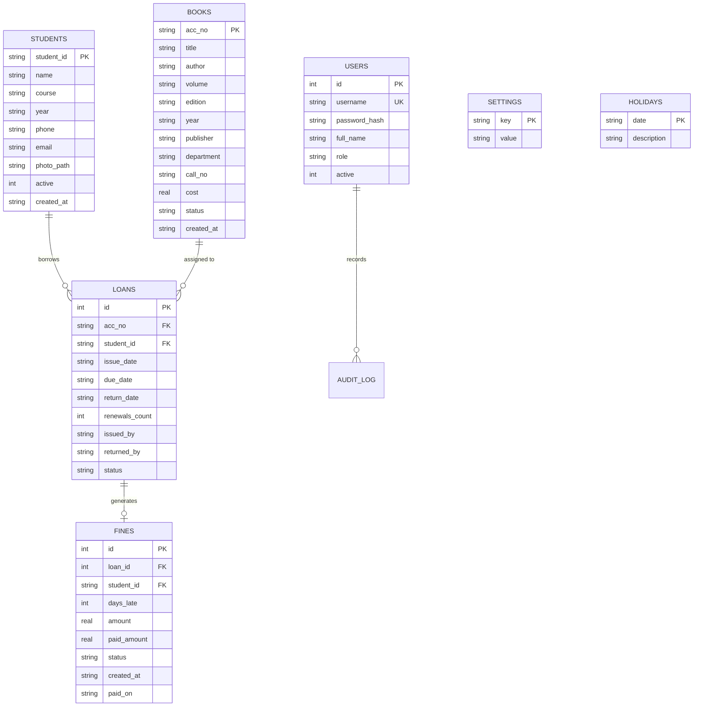

# 📚 LibraryPro — Advanced Desktop Library Management System

A modern, standalone desktop Library Management System built with **Python 3.11**, **PySide6 (Qt)**, and **SQLite**, designed specifically for educational institutions and libraries.

It features rapid barcode / QR code scanning, instant student credential & loan history surfacing, real-time inventory tracking, and an automated rule-based fine calculation engine.

---

## 🌟 Key Features

* **Instant Student Verification via QR / ID:**
  * Scanning or entering a Student ID immediately displays the student's profile photo, academic details, contact information, currently active loans with live fine counters, loan history, and fine balance.
* **Smart Issue & Live Inventory Tracking:**
  * Displays real-time counts of remaining copies for any book title (Total, Available, Issued).
  * Validates issue quotas against the student's borrowing allowance before issuing.
* **Unified Book Search & Borrower Tracking:**
  * Search by Accession Number, Title, or Author.
  * Instantly reveals which student currently holds each physical copy along with issue and due dates.
* **Automated Fine & Working Day Calculation Engine:**
  * Accurately calculates overdue fines based on working days.
  * Automatically excludes **Sundays** and **custom-registered academic/public holidays**.
  * Strict upper bound: Maximum fine is capped at **₹200 per book**.
* **Flexible Excel Data Importer:**
  * Bulk import accession registers and student lists from standard Excel (`.xlsx`) files with tolerant header matching.
* **Audit Logging & Role-based Access:**
  * Supports Admin and Librarian accounts with role-gated actions (e.g., waiving fines, altering system policies).
  * Complete audit trail for book issues, returns, renewals, and payments.
* **Self-Contained Offline Windows Installer:**
  * No Python, runtime dependencies, or command lines required on client machines.

---

## 📋 Business Rules & Operational Policies

| Parameter | Policy / Setting | Description |
| :--- | :--- | :--- |
| **Max Books Per Student** | `2` books | Strict limit on concurrent active loans across all students. |
| **Loan Period** | `15` days | Default borrowing window from the date of issue. |
| **Renewal Period** | `+15` days | Adds 15 days to the existing due date. |
| **Renewal Limits** | **Unlimited** | Students may renew books without limit as long as policy criteria are met. |
| **Overdue Renewals** | **Conditional** | An overdue book can only be renewed **after** outstanding fines are cleared. |
| **Fine Blocking Policy** | **Non-blocking** | Unpaid fines do **not** block new issues (prompts warning to librarian). |
| **Fine Rate** | **₹20 / day** | Assessed for each elapsed working day past the due date. |
| **Maximum Fine Cap** | **₹200 / book** | A hard ceiling stops fine accumulation at ₹200. |
| **Sunday Fine Exemption** | **Excluded** | Sundays are non-working days and are never charged. |
| **Holiday Fine Exemption** | **Excluded** | Configurable calendar of holidays exempted from fine accrual. |

---

## 🖥️ Screen Overview & Workflows

### 1. 🏠 Dashboard
* Real-time metrics: Books Issued Today, Books Returned Today, Overdue Loans, Total Fines Due, Available Inventory, and Registered Students.
* Priority table of currently overdue loans with estimated fines and one-click refresh.

### 2. 📤 Issue Book (2-Step Verification)
* **Step 1:** Scan student QR or enter Student ID.
  * Shows student picture, course, year, currently issued books, loan history, and unpaid fines.
* **Step 2:** Scan book QR or enter Accession Number.
  * Displays title copies breakdown: `Total: X | Available: Y | Issued: Z`.
  * Click **Issue Book** to validate constraints and finalize the transaction.

### 3. 📥 Return & Renew
* Scan book Accession Number.
* Displays book details, borrower identification, days late (excluding Sundays & holidays), and computed fine.
* Options to **Confirm Return** (with instant fine collection prompt) or **Renew (+15 Days)**.

### 4. 🔍 Book Search & Availability
* Unified query bar supporting partial or exact accession numbers, titles, or authors.
* Shows which student holds each loaned copy and lists the current status (`AVAILABLE`, `ISSUED`, `LOST`).

### 5. 🎓 Student Lookup
* Search by Student ID or student name (partial search).
* View complete profile, active loans, return history, and fee breakdown.

### 6. 💰 Fines Management
* Centralized ledger for all pending and partially paid penalties.
* Settle fines with partial or full payment receipts.
* Admin role allows waiving fines with mandatory audit logging.

### 7. 📊 Reports & Analytics
* **Overdue Books Report:** Exportable to Microsoft Excel (`.xlsx`).
* **Issue History Ledger:** Date-range filtered transaction records.
* **Most Borrowed Titles:** Inventory analytics to identify popular library books.

### 8. ⬆️ Data Import
* Import Excel spreadsheets for the **Accession Register** and **Student Directory**.
* Background thread execution with a progress indicator and error reporting.

### 9. ⚙️ System Settings & Backups
* Configure business rules (Max books, Loan duration, Daily fine, Max fine ceiling).
* User access management (Add accounts, change passwords).
* Holiday calendar management.
* One-click database backup and restoration.

---

## 🗄️ Database Schema Architecture



---

## 🚀 Installation & Deployment

### Method 1: Ready-to-Use Windows Installer (Recommended for Users)

Download and double-click the setup installer:
* **Installer:** `LibraryPro_Setup_v1.0.0.exe`
* Automatically installs the application, dependencies, SQLite backend, and desktop shortcuts.
* No Python installation required.

**Default Login:**
* **Username:** `admin`
* **Password:** `admin123`

---

### Method 2: Running from Source (For Developers)

#### 1. Prerequisites
* Python 3.11+
* Git

#### 2. Clone Repository & Setup Virtual Environment
```bash
git clone https://github.com/rnemani96/LibraryPro.git
cd LibraryPro

# Create and activate virtual environment
python -m venv venv
venv\Scripts\activate   # On Windows
```

#### 3. Install Dependencies
```bash
pip install -r requirements.txt
```

#### 4. Run Application
```bash
python main.py
```

---

### Method 3: Compiling Standalone Installer from Source

```bash
# 1. Build native binaries via PyInstaller
pyinstaller LibraryPro.spec --noconfirm --clean

# 2. Compile Windows Installer using Inno Setup
"C:\Users\SMILE\AppData\Local\Programs\Inno Setup 6\ISCC.exe" installer.iss
```
The compiled installer will be saved to `installer_output/LibraryPro_Setup_v1.0.0.exe`.

---

## 📄 License
This project is proprietary software for academic and library administration.
